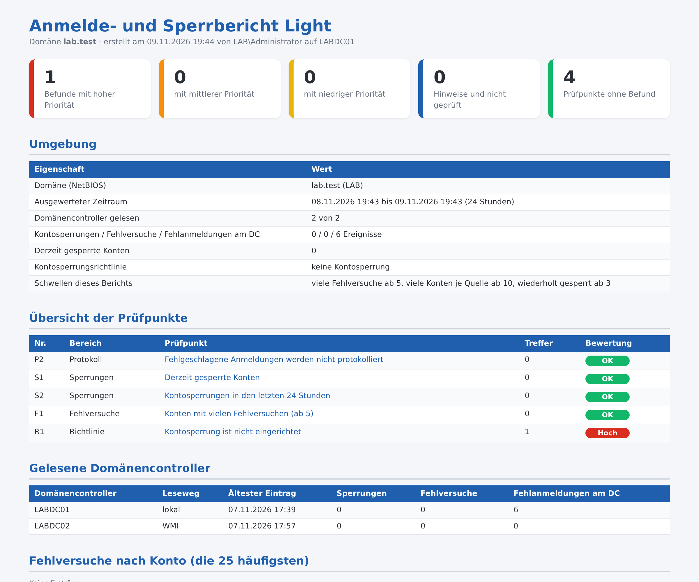

# Anmelde- und Sperrbericht Light – Kontosperrungen und Fehlanmeldungen im Active Directory

Kostenloses PowerShell-Skript: prüft Kontosperrungen und fehlgeschlagene Anmeldungen aus den Sicherheitsprotokollen der Domänencontroller in **5 Punkten** und erzeugt einen übersichtlichen **HTML-Bericht auf Deutsch**. Es arbeitet **ausschließlich lesend**: Es ändert nichts, legt nichts an und überträgt keine Daten.



Der gezeigte Bericht stammt aus einer Testdomäne. Das vollständige Beispiel liegt als [Beispielbericht.html](Beispielbericht.html) bei.

## Was geprüft wird

| Nr. | Bereich | Prüfpunkt |
|---|---|---|
| P2 | Protokoll | Fehlgeschlagene Anmeldungen werden nicht protokolliert |
| S1 | Sperrungen | Derzeit gesperrte Konten |
| S2 | Sperrungen | Kontosperrungen in den letzten N Stunden |
| F1 | Fehlversuche | Konten mit vielen Fehlversuchen (ab N) |
| R1 | Richtlinie | Kontosperrung ist nicht eingerichtet |

Jeder Befund kommt mit Erklärung und Empfehlung.

## Start

```powershell
powershell -ExecutionPolicy Bypass -File .\Anmelde-Sperrbericht-Light.ps1
```

Alle Optionen zeigt `Get-Help .\Anmelde-Sperrbericht-Light.ps1 -Detailed`. Voraussetzungen und Rechte stehen im Kopf des Skripts. Getestet mit Windows Server 2019, 2022 und 2025 in Testdomänen (deutsches Windows).

## Vollversion

Die Light-Version enthält 5 von 18 Prüfpunkten (28 %). Die **Vollversion** prüft zusätzlich unter anderem:

- Sicherheitsprotokoll nicht oder nicht vollständig gelesen
- Sicherheitsprotokoll reicht nicht über den Zeitraum zurück
- Ereignisse ohne lesbare Daten
- Wiederholt gesperrte Konten (ab N Sperrungen)
- Sperrungen von Administratorkonten
- Rechner, die Sperrungen auslösen
- Quellen mit Fehlversuchen für viele Konten (ab N)
- Anmeldeversuche mit unbekannten Benutzernamen
- Anmeldeversuche mit gesperrten, deaktivierten oder abgelaufenen Konten
- Fehlversuche bei Administratorkonten
- Fehlgeschlagene Anmeldungen direkt an Domänencontrollern
- Kontosperrung schwach eingestellt
- Interaktive Anmeldungen an Domänencontrollern

➜ **[Vollversion auf Gumroad](https://mueller86.gumroad.com/l/ztktaaq)** · **[Vollversion auf Etsy](https://www.etsy.com/listing/4593157082)** · **[alle Prüfskripte im Shop](https://www.etsy.com/shop/ITAdminToolsbyMM)**

## Hinweise

- Der Bericht enthält Konto-, Rechner- oder Servernamen – bitte vertraulich behandeln.
- Der Bericht zeigt Auffälligkeiten anhand fester Regeln. Er ersetzt keine Sicherheitsprüfung und erhebt keinen Anspruch auf Vollständigkeit.
- Nutzung auf eigene Verantwortung, siehe [LICENSE](LICENSE).
- Bei der Ausarbeitung wurden KI-Werkzeuge unterstützend eingesetzt; Inhalte und Skript wurden fachlich geprüft und im Testlab getestet.

---

### English

Free, read-only PowerShell script that analyses account lockouts and failed logons from the domain controllers' security logs (5 checks, German HTML report with findings and recommendations). No changes are made and no data leaves the machine. Run: `powershell -ExecutionPolicy Bypass -File .\Anmelde-Sperrbericht-Light.ps1`. The full version with 18 checks: https://mueller86.gumroad.com/l/ztktaaq
